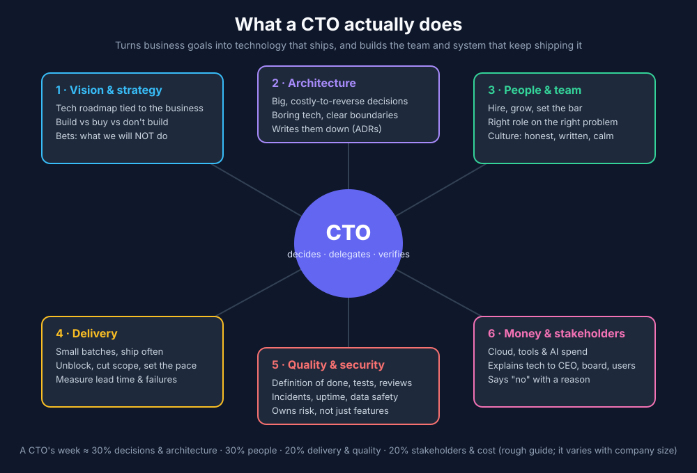

# eleven

> M-theory needs **eleven dimensions** to unify five string theories into one.
> `eleven` unifies eleven roles into one AI team.

A folder of Markdown files you drop into any project. It turns a coding agent
(Claude Code, opencode, Codex, Cursor…) into a full software team: product,
design, architecture, backend, frontend, mobile, QA, DevOps, security, docs,
and a CTO who runs the loop.

It lives in one folder, `eleven/`, at the project root, and it is invisible to git.

## Install into a project

```bash
~/code/lab/eleven/install.sh ~/code/my-project
```

This copies the kit to `my-project/eleven/` and adds `/eleven/` to
`.git/info/exclude`. That file is your local ignore list, so the project's
`.gitignore` is untouched and nothing shows up in `git status`.

To pull in kit improvements later, run `install.sh --update ~/code/my-project`.
Your `project.md`, `work/` and `decisions/` are never touched.

## Use it

In your project, tell the agent:

> Read eleven/AGENTS.md and act as the CTO. Fill eleven/project.md from the codebase.

Then, for each piece of work:

> Read eleven/AGENTS.md and act as the CTO. New item 001: *&lt;your idea&gt;*. Start at step 0.

Or, to pick up where you left off:

> Read eleven/AGENTS.md and act as the CTO. Continue item 001.

You approve the brief, answer open questions, and accept the result.

## Inside `eleven/`

```
AGENTS.md         the operating manual every agent reads first
project.md        facts about this project (filled on first run)
agents/*.md       the 11 roles
templates/        brief, plan, tasks, notes, report, decision, project
work/<NNN>-slug/  one folder per item: the shared "ledger"
decisions/        decision records that outlive an item
docs/             the habits and research behind it, and the CTO role
install.sh        install/update into another project
```

## Why this works

It applies the manager/worker/ledger loop from *GVS5H* ([arXiv:2608.26480](https://arxiv.org/abs/2608.26480)):
fresh single-task workers, shared files with size caps, a verifier that can veto
"done", and guards against runaway loops. That loop lifted a cheap model above a
frontier one on hard coding problems. See [docs/working-with-ai.md](docs/working-with-ai.md).


