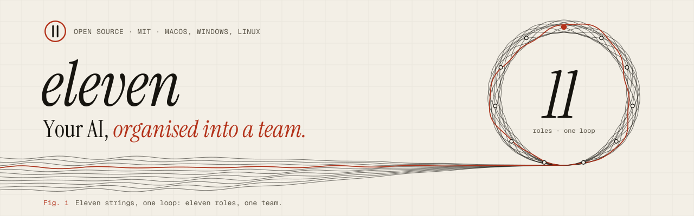
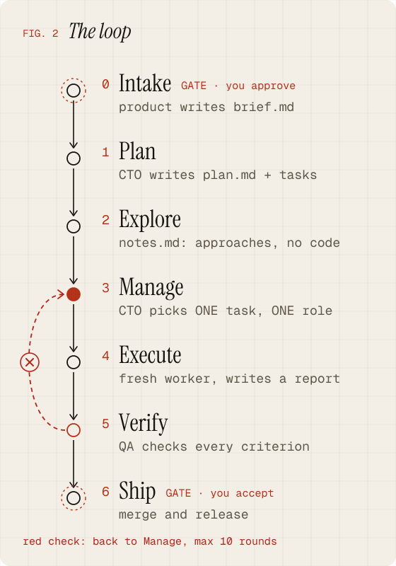
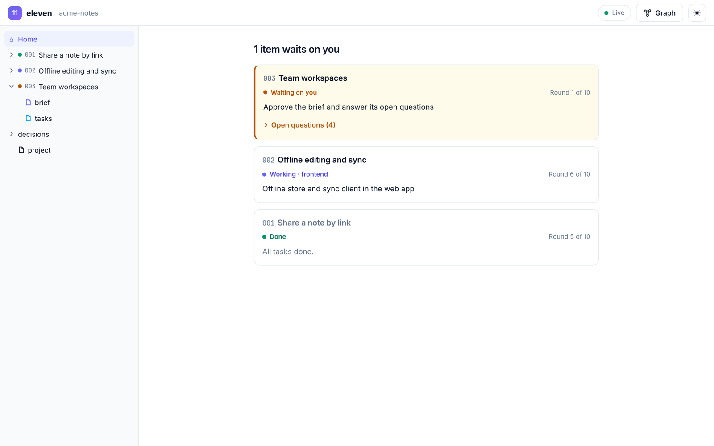
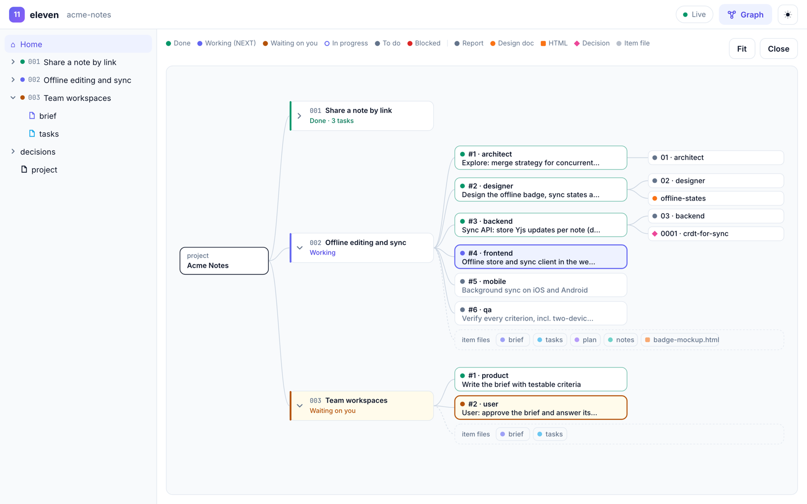

<p align="center">
  <picture>
    <source media="(prefers-color-scheme: dark)" srcset="docs/brand/banner-dark.svg">
    
  </picture>
</p>

<p align="center">
  <a href="LICENSE"></a>
  
  
  <a href="https://eleven.rtima.org"></a>
</p>

<p align="center">
  <a href="https://eleven.rtima.org"><b>Website</b></a> ·
  <a href="https://eleven.rtima.org/app/"><b>Live UI</b></a> ·
  <a href="#quick-start"><b>Quick start</b></a> ·
  <a href="docs/working-with-ai.md"><b>The research</b></a> ·
  <a href="https://eleven.rtima.org/ar/" lang="ar" dir="rtl"><b>بالعربية</b></a>
</p>

> M-theory needs **eleven dimensions** to unify five string theories into one.
> **eleven** unifies eleven roles into one AI team.

**eleven** is a folder of Markdown files you drop into any project. It turns your coding agent into a
software team: product, design, architecture, backend, frontend, mobile, QA, DevOps, security and docs,
led by a CTO who runs the loop. You stay the CEO.

- **One folder, invisible to git.** It lives in `eleven/` and hides itself through `.git/info/exclude`.
- **No server, no dependencies.** About 25 Markdown files you can read in fifteen minutes.
- **Any agent.** Claude Code, Codex, opencode, Cursor… anything that can read files and follow instructions.

<p dir="rtl" lang="ar">ذكاؤك الاصطناعي، يعمل كفريق. <a href="https://eleven.rtima.org/ar/">اقرأ الصفحة بالعربية ←</a></p>

## Quick start

Clone the kit once, then install it into any project.

**macOS / Linux**

```bash
git clone https://github.com/AbdullhRtima/eleven.git ~/eleven
~/eleven/install.sh ~/code/my-project
```

**Windows (PowerShell)**

```powershell
git clone https://github.com/AbdullhRtima/eleven.git $HOME\eleven
~\eleven\install.ps1 C:\code\my-project
```

If scripts are blocked: `powershell -ExecutionPolicy Bypass -File $HOME\eleven\install.ps1 C:\code\my-project`

The installer copies the kit to `my-project/eleven/` and adds `/eleven/` to `.git/info/exclude`, your
local ignore list. Your `.gitignore` is untouched and nothing shows up in `git status`.

**Then tell your agent to lead.** Start it in your project and say:

> Read eleven/AGENTS.md and act as the CTO. Fill eleven/project.md from the codebase.

Then, for each piece of work:

> Read eleven/AGENTS.md and act as the CTO. New item 001: *&lt;your idea&gt;*. Start at step 0.

To pick up where you left off: *Read eleven/AGENTS.md and act as the CTO. Continue item 001.*

<details>
<summary><b>Updating the kit</b></summary>

Run `git pull` in `~/eleven`, then `~/eleven/install.sh --update ~/code/my-project`
(Windows: `~\eleven\install.ps1 -Update C:\code\my-project`). This refreshes `AGENTS.md`, `agents/`,
`templates/`, `docs/` and `ui/`. Your `project.md`, `work/` and `decisions/` are never touched.
</details>

## How it works

Every piece of work is an **item** with its own folder: the **ledger**. The CTO picks **one task for one role**.
That role runs in a **fresh context**, does the task, and writes a report. QA can veto "done". You approve
the brief and accept the result.

<p align="center">
  <picture>
    <source media="(prefers-color-scheme: dark)" srcset="docs/brand/loop-dark.svg">
    
  </picture>
</p>

**The guards** keep the loop honest:

| Guard | Rule |
|---|---|
| Round budget | At most **10** manage → execute rounds per item, then it stops and reports to you. |
| No progress | The same task to the same role twice? Stop and ask you. |
| Small memory | `plan.md` ≤ 4,000 chars, `notes.md` ≤ 8,000. Rewritten, never appended. |
| Open questions | They pause the loop. Nobody guesses about intent, money, data or security. |
| Evidence | Reports paste the real build and test output. "Should work" isn't evidence. |

The full manual is [AGENTS.md](AGENTS.md). It's short on purpose.

## The team

Each role is one short Markdown file: what it does, what it never does, and when it's done.

| | Role | Owns |
|---|---|---|
| ★ | **You**, the CEO | the *why*; you approve the brief and accept the result |
| 1 | [CTO](agents/cto.md) | the loop, the plan, who works next, merging |
| 2 | [Product manager](agents/product.md) | the brief, scope, acceptance criteria |
| 3 | [Designer](agents/designer.md) | flows, screens, states, copy |
| 4 | [Architect](agents/architect.md) | structure, interfaces, data, decisions |
| 5 | [Backend](agents/backend.md) | APIs, domain logic, data |
| 6 | [Frontend](agents/frontend.md) | web UI |
| 7 | [Mobile](agents/mobile.md) | iOS / Android / cross-platform |
| 8 | [QA](agents/qa.md) | verification; can veto "done" |
| 9 | [DevOps](agents/devops.md) | build, CI, deploy, observability |
| 10 | [Security](agents/security.md) | threats, secrets, dependencies |
| 11 | [Tech writer](agents/writer.md) | README, docs, changelog |

Not every item needs everyone. A one-line bug fix is CTO → engineer → QA.

## Watch it work

Open **[eleven.rtima.org/app](https://eleven.rtima.org/app/)** (or `eleven/ui/index.html` locally) in Chrome
or Edge and choose your project's `eleven` folder. It reads the ledger in your browser while your agents
write it, refreshing every 2 seconds. Nothing is uploaded. Firefox and Safari open a snapshot instead.

<table>
  <tr>
    <td width="50%">
      <picture>
        <source media="(prefers-color-scheme: dark)" srcset="site/assets/ui-home-dark.png">
        
      </picture>
    </td>
    <td width="50%">
      <picture>
        <source media="(prefers-color-scheme: dark)" srcset="site/assets/ui-graph-dark.png">
        
      </picture>
    </td>
  </tr>
  <tr>
    <td><b>Home.</b> One card per item. Items waiting on you come first, with their open questions.</td>
    <td><b>Work graph.</b> Project → items → tasks → what each task produced, coloured by status.</td>
  </tr>
</table>

There's also a file tree with a reader for every ledger file; HTML mockups open in a sandboxed frame.
The screenshots use a synthetic sample project.

## Why it works

eleven's loop comes from *GVS5H* (Gao et al., [arXiv:2608.26480](https://arxiv.org/abs/2608.26480)): one
model split into a **manager** and **fresh single-task workers** that share state only through a few
size-capped files on disk, with a verifier that can veto "done".

| On 100 hard LiveCodeBench problems | Result |
|---|---|
| Same model, alone → in the loop | **66.8 → 92.4** (+25.6 points) |
| Orchestrated cheap model vs frontier model | **93.0 vs 90.4** |
| Cost of the orchestrated run | about **9%** of the frontier model |

**Honest caveats:** the loop uses about 3× the tokens of a single call. Not every model gained, and some got
worse. Strong models gain least. eleven adds the roles a real product team needs on top of that loop.
More in [docs/working-with-ai.md](docs/working-with-ai.md).

## Inside `eleven/`

```
AGENTS.md         the operating manual every agent reads first
project.md        facts about this project (filled on first run)
agents/*.md       the 11 roles
templates/        brief, plan, tasks, notes, report, decision, project
work/<NNN>-slug/  one folder per item: the shared ledger
decisions/        decision records that outlive an item
docs/             the habits and research behind it, the CTO role, the roadmap
ui/index.html     the live browser UI
install.sh        install / update (macOS, Linux)
install.ps1       install / update (Windows)
```

This repo also holds `site/`, the landing page at [eleven.rtima.org](https://eleven.rtima.org).

## Roadmap

Guardrail hooks, a reviewer role, slash commands and a v0.1.0 release are next.
See [docs/roadmap.md](docs/roadmap.md).

## Contributing

Issues and pull requests are welcome at [github.com/AbdullhRtima/eleven](https://github.com/AbdullhRtima/eleven).
Keep changes small and the kit plain Markdown. If you change the live UI, run `node ui/test/run.mjs`
(headless Chrome) before opening a PR.

## Licence

[MIT](LICENSE) © 2026 Abdullah Rtima
