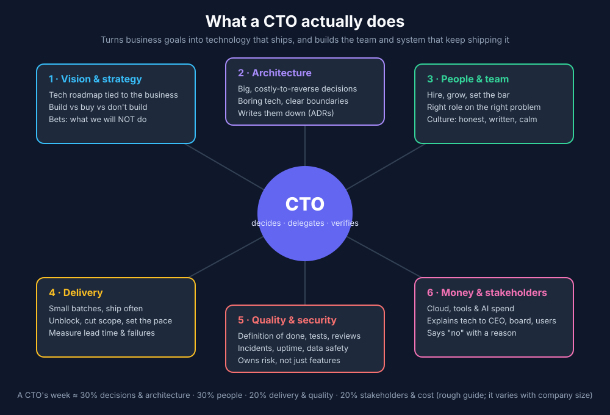

# What a CTO does, and how you play that role with AI

## The job in one line
A CTO turns business goals into technology that ships, and builds the team and the
system that keep shipping it. The best CTOs write little code. Their leverage is
**decisions, delegation and verification**.

## A typical week

| When | What |
|---|---|
| Mon | Priorities with the CEO and product. What matters this week, and what we're saying no to. |
| Daily | Unblock people. Review the 1–2 decisions that are expensive to undo. |
| Mid-week | Architecture and design reviews. Read ADRs, ask "what happens when this fails?" |
| Ongoing | 1:1s, hiring, raising the bar on code review and tests. |
| Ongoing | Incidents and reliability: what broke, why, and what stops it happening again. |
| Fri | Delivery metrics (lead time, deploy frequency, change failure rate, time to restore). Cost review. |

## How this maps onto `eleven`

| Real company | Here |
|---|---|
| CEO sets the why and accepts the result | **You.** You approve the brief and accept the result. |
| CTO runs the team | The `cto` agent runs the loop ([AGENTS.md](../AGENTS.md)) |
| Team members | The other 10 agents in [eleven/agents/](../agents/) |
| Standups, tickets, wiki | The ledger: `brief`, `plan`, `tasks`, `notes`, `reports` |
| Architecture review board | `eleven/decisions/` |
| "Done means done" | QA's veto + the definition of done |

To grow toward CTO thinking yourself: read the CTO agent's `plan.md` and
`tasks.md` before each round and ask whether you would have chosen the same
next task. When you wouldn't, override it and note why in `notes.md`. That
habit is the CTO skill.
